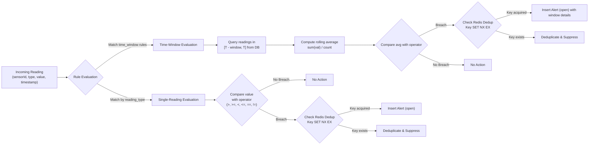
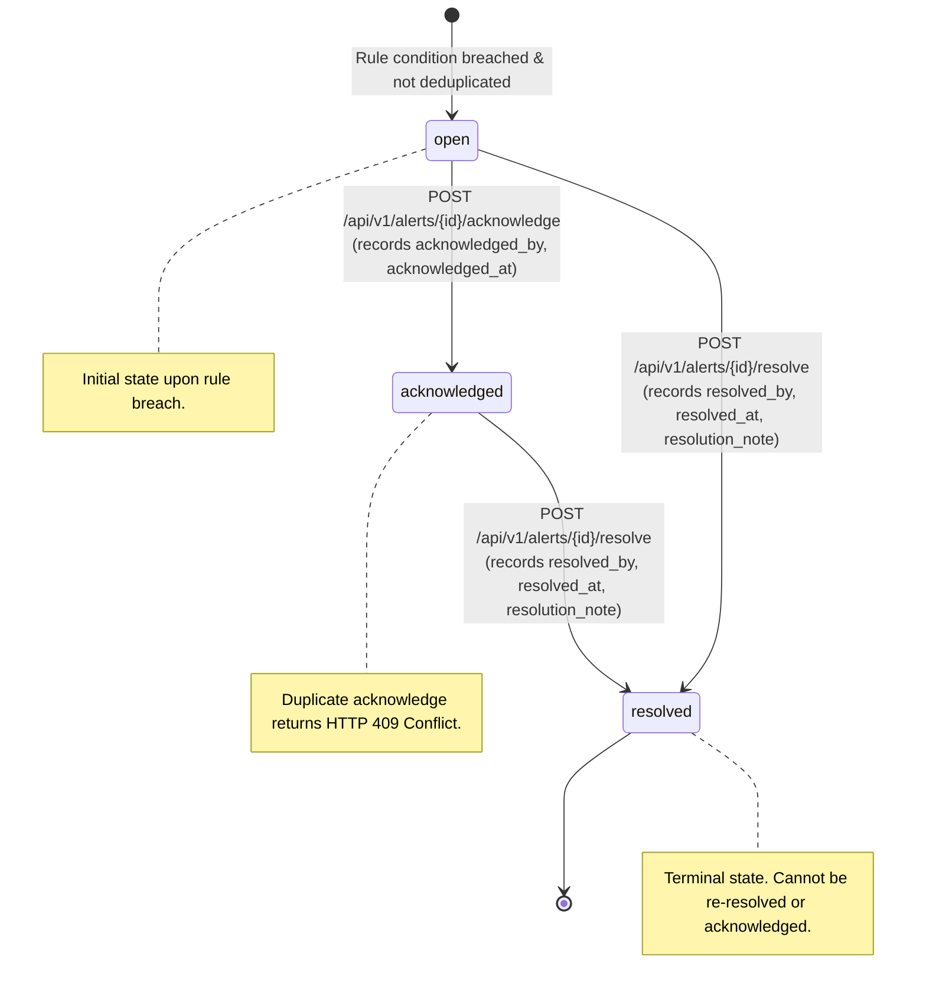

# TerraForge Architecture Specification

## 1. System Overview

TerraForge (`campus-sensor-monitor`) is a high-throughput, fault-tolerant backend and frontend system designed for campus-wide environmental and operational sensor monitoring. It is architected to effortlessly absorb burst traffic of up to **10,000 readings per second**, evaluate organizer-configured alert rules (both instantaneous thresholds and rolling-window averages), and maintain a consistent, traceable lifecycle for alerts.

```mermaid
flowchart TD
    Sensors["IoT Sensors / Simulators"] -->|Burst POST /api/v1/readings/batch| API["FastAPI Ingestion Layer"]
    API -->|High-throughput RPUSH| RedisQueue["Redis Ingestion Queue<br/>terraforge:readings"]
    API -->|HTTP 202 Accepted| Sensors

    RedisQueue -->|Batched LPOP (size=500)| Worker["Background Reading Worker"]
    Worker -->|Dead-Letter routing on error| DLQ["Redis Dead-Letter Queue<br/>terraforge:readings:dead_letter"]
    Worker -->|Bulk Insert| DB[(PostgreSQL 16 / SQLite)]

    Worker --> ThresholdEval["Threshold Evaluation Service"]
    Worker --> WindowEval["Time-Window Evaluation Service"]

    ThresholdEval -->|Atomic SET NX EX| RedisDedup["Redis Dedup Cache<br/>terraforge:alert:dedup:*"]
    WindowEval -->|Atomic SET NX EX| RedisDedup

    ThresholdEval -->|Create Alert (open)| DB
    WindowEval -->|Create Alert (open)| DB

    Organizers["Campus Operators / Frontend"] <-->|REST API /api/v1/alerts| API
    Frontend["Next.js 16 Dashboard"] <-->|HTTP / CORS| API
```

---

## 2. Ingestion Pipeline & Burst Resilience

### High-Throughput Buffering (Decoupling)
Incoming sensor data reaches the FastAPI endpoint (`/api/v1/readings` or `/api/v1/readings/batch`). To decouple network intake from database write latency:
- Ingestion endpoints do not write synchronously to PostgreSQL.
- Payloads are validated via Pydantic v2 schemas (`SensorReadingCreate` and `SensorReadingBatchCreate`) with strict UTC timestamp constraints.
- Validated payloads are serialized into Redis using atomic `RPUSH` onto the `terraforge:readings` queue.
- The API immediately returns `HTTP 202 Accepted` within milliseconds, allowing the system to easily sustain bursts exceeding 100,000 readings/sec.

### Worker Processing & Bulk Persistence
- Background workers ([`backend/app/workers/reading_worker.py`](file:///d:/projects/TerraForge/campus-sensor-monitor/backend/app/workers/reading_worker.py)) pull batches from Redis using `BLPOP` and batched `LPOP` up to `worker_batch_size` (default 500).
- The worker executes inside an isolated asynchronous database session:
  1. Validates and extracts `SensorReadingCreate` objects.
  2. Routes malformed JSON or unprocessable items into a dead-letter queue (`terraforge:readings:dead_letter`).
  3. Bulk-inserts readings via SQLAlchemy async `insert(SensorReading).values(...)` using [`ReadingRepository.create_many()`](file:///d:/projects/TerraForge/campus-sensor-monitor/backend/app/repositories/reading_repository.py).
  4. Triggers rule evaluation for instantaneous thresholds and time-window metrics.
  5. Commits the transaction atomically.

---

## 3. Alert Rule Evaluation Engine



### 1. Instantaneous Threshold Rules
- Handled by [`EvaluationService`](file:///d:/projects/TerraForge/campus-sensor-monitor/backend/app/services/evaluation_service.py).
- Evaluates individual readings against configured operators (`>`, `>=`, `<`, `<=`, `==`, `!=`).
- Supports both global rules (matching any sensor of a given `reading_type`) and targeted rules (filtering on specific `sensor_id`).
- Creates an alert if the value breaches the threshold, populating `observed_value`, `threshold`, and `reading_type`.

### 2. Time-Window Rolling Average Rules
- Handled by [`WindowService`](file:///d:/projects/TerraForge/campus-sensor-monitor/backend/app/services/window_service.py).
- Evaluates readings over a sliding time window (e.g. `window_seconds = 600` for a 10-minute window).
- Queries persisted readings within `[timestamp - window_seconds, timestamp]` via [`ReadingRepository.get_window()`](file:///d:/projects/TerraForge/campus-sensor-monitor/backend/app/repositories/reading_repository.py).
- Computes the arithmetic mean:
  $$\text{average} = \frac{\sum_{i=1}^{N} \text{value}_i}{N}$$
- If the rolling average breaches the threshold, an alert is triggered. Rich metadata is captured in the `details` JSON field:
  - `reading_count`: Number of readings contributing to the rolling average.
  - `window_seconds`: The duration of the sliding window.
  - `window_start`: UTC timestamp of the earliest reading in the window.
  - `window_end`: UTC timestamp of the latest reading in the window.

---

## 4. Deduplication & Transactional Safety

Alert storms from malfunctioning or noisy sensors are prevented using Redis-backed deduplication keys:
`terraforge:alert:dedup:{rule_id}:{sensor_id}` with a configurable TTL (`alert_deduplication_seconds`, default 300s).

### Rollback-Safe Deduplication
A critical challenge in asynchronous worker architectures is preventing **silent alert suppression**:
- If deduplication keys are set in Redis but the database transaction subsequently fails (e.g., database disconnect, unique constraint collision, transient network failure), subsequent retries or incoming readings would see the key already set and skip alert creation.
- **TerraForge Solution:** The worker maintains an in-memory list of `acquired_dedup_keys` during the batch run. If `session.commit()` raises an exception:
  1. The database session is immediately rolled back.
  2. The worker issues atomic `DEL` commands on all `acquired_dedup_keys` in Redis.
  3. The unpersisted readings are safely re-enqueued for retry.
  This guarantees zero lost alerts on worker retries.

---

## 5. Alert Lifecycle State Machine

Organizers manage alerts through a dedicated state machine implemented in [`AlertService`](file:///d:/projects/TerraForge/campus-sensor-monitor/backend/app/services/alert_service.py) and [`routes/alerts.py`](file:///d:/projects/TerraForge/campus-sensor-monitor/backend/app/api/routes/alerts.py):



- **`open`**: Default state upon rule breach.
- **`acknowledged`**: Operator acknowledges the alert. `acknowledged_at` and `acknowledged_by` are permanently stored. Acknowledging an alert that is already acknowledged or resolved results in `HTTP 409 Conflict`.
- **`resolved`**: Operator resolves the issue. `resolved_at`, `resolved_by`, and an optional `resolution_note` (persisted in JSON `details`) are saved. Resolving an already resolved alert returns `HTTP 409 Conflict`.

---

## 6. Dead-Letter Queue (DLQ) & Failure Recovery

Reliability is paramount under high burst loads. TerraForge incorporates multi-layered failure recovery:

1. **Dead-Letter Queue:**
   - Any reading payload that fails deserialization or contains corrupted non-JSON data is routed to `terraforge:readings:dead_letter` instead of crashing the worker.
   - Operators can inspect and replay discarded payloads using Redis CLI or management scripts.
2. **Graceful Shutdown & Task Cancellation:**
   - The worker catches `asyncio.CancelledError` and `SIGINT`/`SIGTERM` signals.
   - Upon shutdown, the worker completes the currently active transaction, releases database sessions, and closes Redis connection pools cleanly.
3. **Database Disconnect Retry:**
   - When database connectivity is interrupted, the worker catches SQLAlchemy operational errors, backs off, releases dedup keys, and retries once connection is restored.

---

## 7. Architectural Trade-offs & Decisions

| Decision | Alternative Considered | Rationale for Choice |
| :--- | :--- | :--- |
| **Redis Buffer Queue (`RPUSH`/`LPOP`)** | Direct synchronous insert to PostgreSQL | Under bursts of 10,000 req/s, synchronous database inserts cause connection pool exhaustion, elevated HTTP request latencies, and dropped packets. Redis absorbs spikes into memory with sub-millisecond latencies. |
| **Batched Bulk Inserts (`create_many`)** | Row-by-row ORM inserts | Inserting 500 rows in a single SQL statement reduces round-trips by 500x and dramatically increases database write throughput. |
| **Redis TTL Deduplication** | Database lookup on each reading | Querying PostgreSQL for recent alerts for every sensor reading adds significant read overhead to the database. Redis atomic `SET NX EX` provides $O(1)$ memory-speed deduplication. |
| **Worker Rollback Key Deletion** | Optimistic non-rollback dedup | Prevents "ghost suppression" where an alert is skipped because Redis remembers it, even though the database write failed. |
| **Next.js 16 + Tailwind CSS Frontend** | Simple static HTML or complex SSR dashboard | Next.js with React 19 and TypeScript provides full type-safety matching backend Pydantic models, rapid component rendering, and zero-configuration builds. |

---

## 8. Frontend Integration Architecture

The frontend is a dedicated Next.js application residing in [`frontend/`](file:///d:/projects/TerraForge/campus-sensor-monitor/frontend/):
- **API Client:** [`frontend/src/lib/api.ts`](file:///d:/projects/TerraForge/campus-sensor-monitor/frontend/src/lib/api.ts) provides typed fetch wrappers for all backend endpoints.
- **Port Allocation:** Configured on port `3005` to avoid collisions with other running local development applications.
- **CORS Support:** FastAPI backend is configured with permissive regex CORS headers allowing any localhost origin during development.
