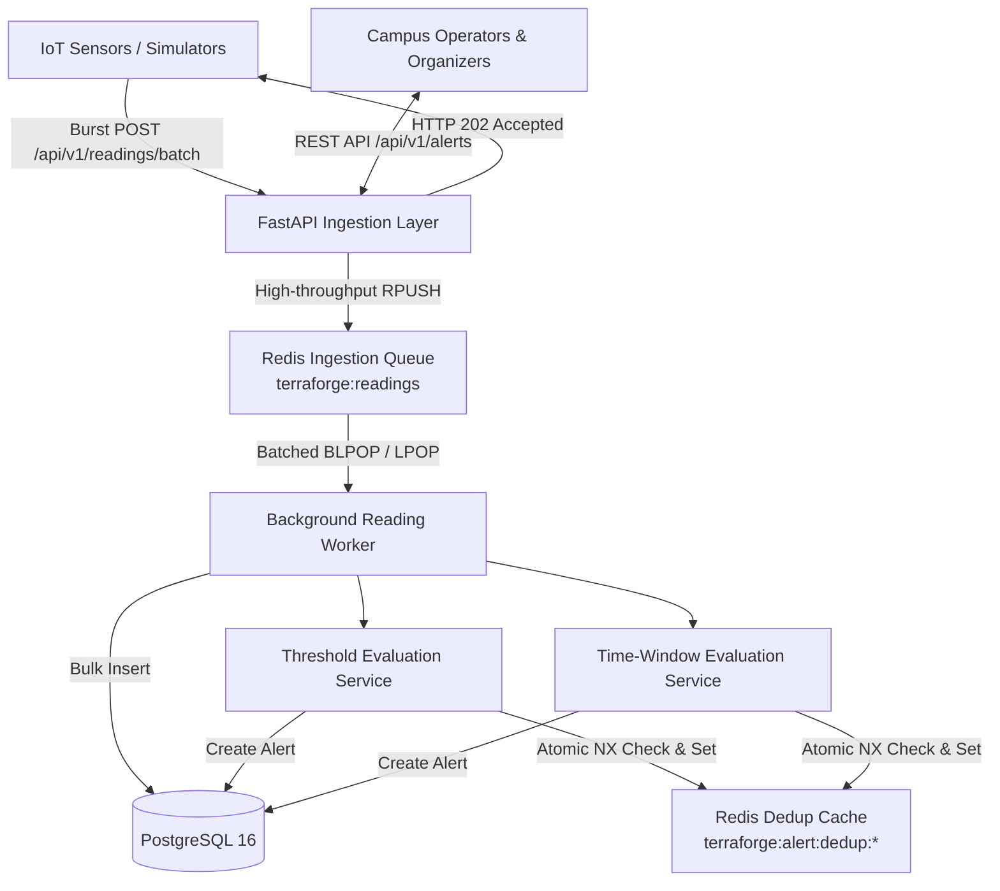

# TerraForge Architecture

## 1. System Overview

TerraForge (`campus-sensor-monitor`) is a high-throughput, fault-tolerant backend system designed for campus-wide environmental and operational sensor monitoring. It is architected to effortlessly absorb burst traffic of up to **10,000 readings per second**, evaluate organizer-configured alert rules (both instantaneous thresholds and rolling-window averages), and maintain a consistent, traceable lifecycle for alerts.

---

## 2. Ingestion Pipeline & Burst Resilience

### High-Throughput Buffering
Incoming sensor data reaches the FastAPI endpoint (`/api/v1/readings` or `/api/v1/readings/batch`). To decouple network intake from database write latency:
- Ingestion endpoints do not write synchronously to PostgreSQL.
- Payloads are validated via Pydantic v2 schemas and immediately serialized into Redis using `RPUSH` onto the `terraforge:readings` queue.
- The API returns `HTTP 202 Accepted` within milliseconds, allowing the system to easily sustain bursts exceeding 10,000 readings/sec.

### Worker Processing
- Background workers (`backend/app/workers/reading_worker.py`) pull batches from Redis using `BLPOP` and `LPOP`.
- The worker executes inside an isolated asynchronous database session:
  1. Validates and extracts `SensorReadingCreate` objects.
  2. Discards or routes malformed JSON into a dead-letter queue (`terraforge:readings:dead_letter`).
  3. Bulk-inserts readings via `ReadingRepository.create_many()`.
  4. Triggers rule evaluation for instantaneous thresholds and time-window metrics.
  5. Commits the transaction atomically.

---

## 3. Alert Rule Evaluation Engine

### 1. Instantaneous Threshold Rules
- Triggered whenever a single reading value breaches a defined threshold (e.g., `temperature > 35.0`).
- Operators supported: `>`, `>=`, `<`, `<=`, `==`, `!=`.
- Supports global rules (matching all sensors of a `reading_type`) or sensor-targeted rules.

### 2. Time-Window Rolling Average Rules
- Triggered when the average value over a specified sliding window duration (e.g. `window_seconds = 600`) breaches a threshold.
- The service queries the persisted readings within the window `[timestamp - window_seconds, timestamp]` from `ReadingRepository.get_window()`.
- Calculates `average = sum(values) / count` and evaluates the condition.
- Metadata including `reading_count`, `window_start`, and `window_end` is saved into `alert.details`.

---

## 4. Deduplication & Transactional Safety

Alert storms are prevented using Redis-backed deduplication keys:
`terraforge:alert:dedup:{rule_id}:{sensor_id}` with a configurable TTL (`alert_deduplication_seconds`).

### Rollback-Safe Deduplication
A critical challenge in asynchronous worker architectures is preventing **silent alert suppression**:
- If deduplication keys are set in Redis but the database transaction subsequently fails (e.g. database disconnect, serialization error), subsequent retries would see the key already set and skip alert creation.
- **TerraForge Solution:** The worker tracks all `acquired_dedup_keys` within the batch. If `session.commit()` raises an exception, the worker immediately rolls back the session and deletes all acquired deduplication keys from Redis before re-enqueuing the batch. This guarantees zero lost alerts on retry.

---

## 5. Alert Lifecycle Management

Organizers manage alerts through a dedicated state machine:
- **`open`**: Default state upon rule breach.
- **`acknowledged`**: Operator marks the alert as seen and under investigation. `acknowledged_at` and `acknowledged_by` are recorded.
- **`resolved`**: Operator resolves the issue. `resolved_at`, `resolved_by`, and an optional `resolution_note` (persisted in JSON `details`) are recorded.
- Only `open` alerts can be acknowledged; duplicate resolutions are rejected with `HTTP 409 Conflict`.
